<div align="center">

# 🛡️ SIEM Dashboard & Visualizations on Azure

**Project 19 of 20 — Blue Team Defense Projects**

Wazuh / OpenSearch SIEM · Azure Cloud Deployment · Failed-Login Visualization


A single-node Wazuh SIEM (Manager, Indexer, Dashboard) deployed on an Azure VM because my 4GB laptop cannot host it, one Windows endpoint connected as an agent, simulated failed-login activity, and a saved "Top Attacker IPs" visualization. Every failure along the way and its fix is recorded, along with what this lab does not prove.

### [📑 Open the visual index](INDEX.md)

</div>

---

## 📑 Table of Contents

1. [At a Glance](#at-a-glance)
2. [Project Background](#project-background)
3. [Environment](#environment)
4. [Project Flow](#project-flow)
5. [Module 1 — Azure VM and Network Setup](#module-1)
6. [Module 2 — Wazuh Installation and Recovery](#module-2)
7. [Module 3 — Endpoint Agent and Alert Generation](#module-3)
8. [Module 4 — Visualization and Dashboard](#module-4)
9. [Coverage Snapshot](#coverage-snapshot)
10. [Troubleshooting Pipeline](#troubleshooting-pipeline)
11. [Command Reference](#command-reference)
12. [Project Summary](#project-summary)
13. [Challenges & Fixes](#challenges-fixes)
14. [Scope & Limitations](#scope-limitations)
15. [What I Learned](#what-i-learned)
16. [Skills Demonstrated](#skills-demonstrated)
17. [Screenshot Index](#screenshot-index)
18. [Repo Structure](#repo-structure)

---

<a id="at-a-glance"></a>
## 📊 At a Glance

| ☁️ Cloud VMs | 🖥️ Agents | 📈 Visualizations | 🖼️ Screenshots | 💰 Cost |
|:---:|:---:|:---:|:---:|:---:|
| **1** | **1** | **1** | **22** | **Student credits** |

---

<a id="project-background"></a>
## 📖 Project Background

The goal of this project was a working SIEM dashboard: collect alerts in a Wazuh/OpenSearch stack and turn them into a chart that shows which source IPs generate the most failed logins.

My laptop (4GB RAM) cannot run the Wazuh Indexer next to everything else, so the server side was moved to a free Azure for Students subscription. The laptop only runs the lightweight Wazuh agent and a browser.

| Plan Item | Decision |
|---|---|
| SIEM host | One Azure Ubuntu VM, Wazuh all-in-one install |
| VM size | Standard B2ls v2 (2 vCPU, 4 GiB RAM), kept as created |
| RAM shortfall | 4 GB swap file added, installer hardware check skipped with `-i` |
| Endpoint | The Windows 10 laptop, as a Wazuh agent |
| Attack data | Simulated failed SSH logins from my own machine, no outside traffic |

> [!NOTE]
> The 4 GiB VM is below Wazuh's recommended size for an all-in-one install. It worked for a one-agent lab, but this is not a production sizing.

---

<a id="environment"></a>
## 🖧 Environment

| Item | Value |
|---|---|
| **Cloud** | Microsoft Azure, Azure for Students subscription |
| **Region** | India South Central |
| **VM** | `lab-server`, Standard B2ls v2 (2 vCPU, 4 GiB RAM) |
| **OS** | Ubuntu Server 24.04 LTS |
| **OS Disk** | Premium SSD LRS, resized from 30 GiB to 64 GiB during the project |
| **SIEM** | Wazuh 4.14.9 (Manager + Indexer + Dashboard, single node) |
| **Endpoint** | `malaika-laptop`, Windows 10 Pro, Wazuh agent 4.14.9 |
| **Public IP** | `<VM-Public-IP>` |
| **Dashboard URL** | `https://<VM-Public-IP>` (self-signed certificate) |

### 🗺️ Lab Topology

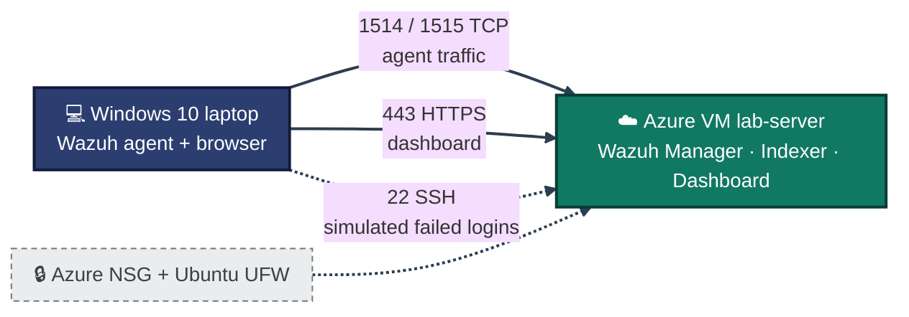
<p align="center"><em>The laptop is both the monitored endpoint and the machine used to view the dashboard. Ports 22 and 443 are limited to my public IP at the Azure firewall.</em></p>

---

<a id="project-flow"></a>
## ⏱️ Project Flow

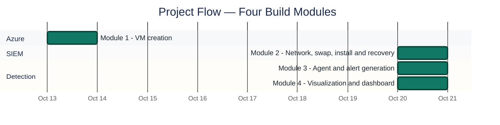
<p align="center"><em>VM created on 13 Oct 2026. Installation, agent, alerts and dashboard were completed on 20 Oct 2026.</em></p>

---

<a id="module-1"></a>
## 🔵 Module 1 — Azure VM and Network Setup

**Objective:** Have a reachable Linux VM in Azure with only the ports the lab needs.

### Step 1 — VM overview ✅

`lab-server` runs Ubuntu 24.04 LTS on a Standard B2ls v2 (2 vCPU, 4 GiB) in India South Central.

<p align="center">
  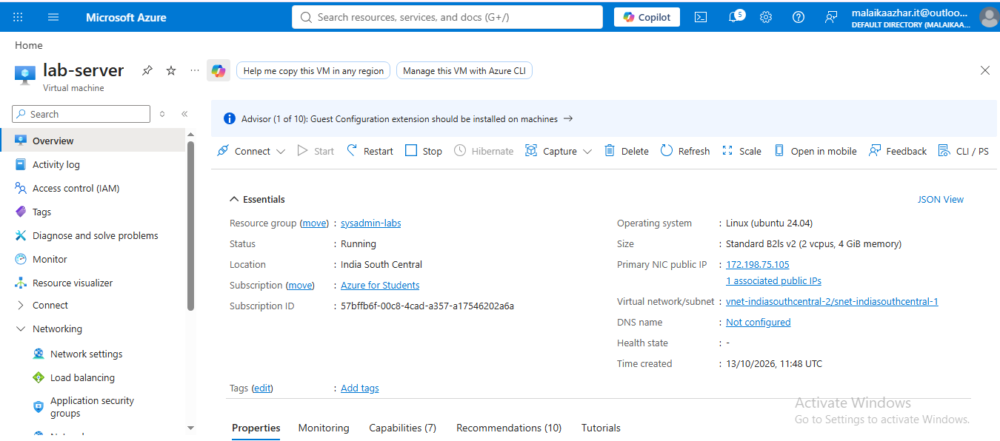<br>
  <em>Exhibit 1 — Azure portal: `lab-server` Running, Ubuntu 24.04, 4 GiB RAM</em>
</p>

### Step 2 — Inbound firewall rules (NSG) ✅

Added an inbound rule for TCP 1514 and 1515 (Wazuh agent communication). SSH (22) and HTTPS (443) were limited to my own public IP instead of "Any".

<p align="center">
  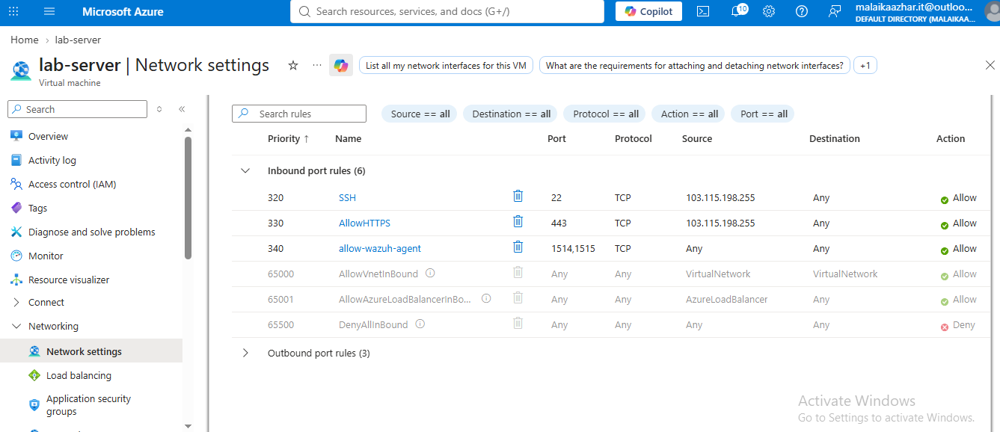<br>
  <em>Exhibit 2 — NSG rules: SSH and HTTPS restricted to one source IP, agent ports 1514-1515 open</em>
</p>

### Step 3 — SSH access ✅

The first attempt used a placeholder key path and failed with `Permission denied (publickey)`. After locating the real `.pem` file in Downloads, the connection worked.

<p align="center">
  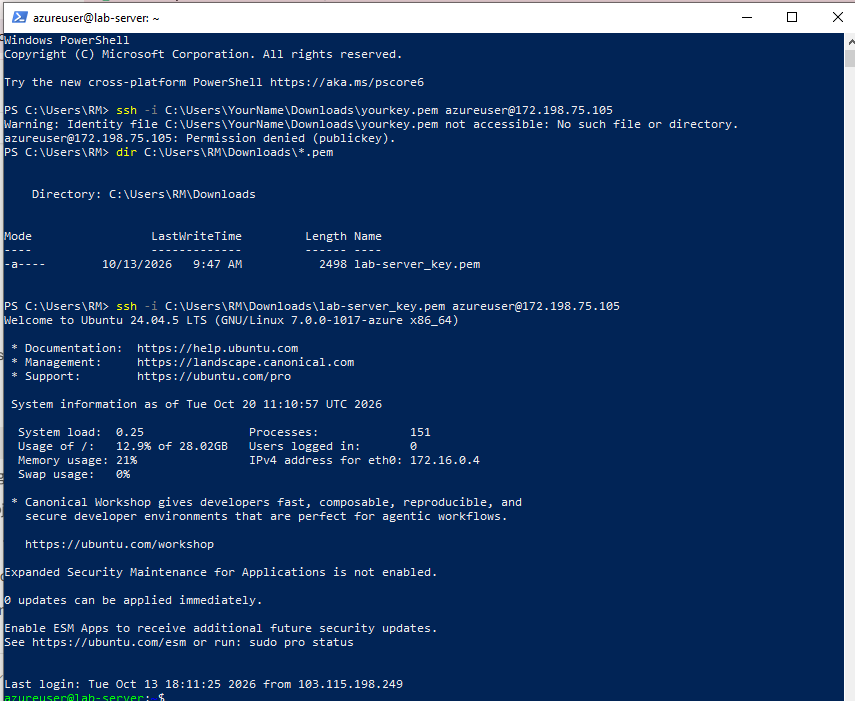<br>
  <em>Exhibit 3 — Successful SSH login to `lab-server` using the downloaded key</em>
</p>

### Step 4 — Swap space ✅

With only 4 GiB of RAM, a 4 GB swap file was created and added to `/etc/fstab` so it survives reboots.

<p align="center">
  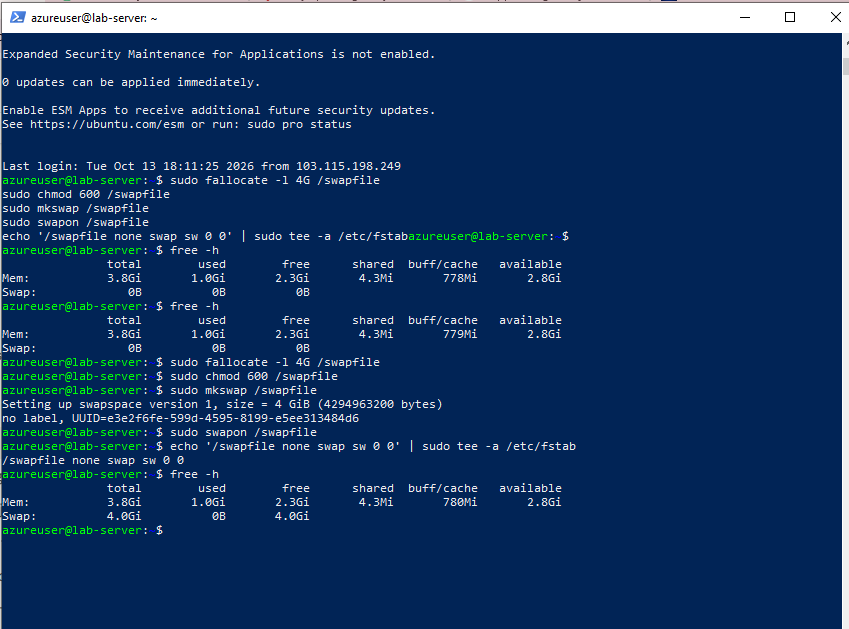<br>
  <em>Exhibit 4 — `free -h` showing 4.0Gi of swap after setup</em>
</p>

---

<a id="module-2"></a>
## 🟠 Module 2 — Wazuh Installation and Recovery

**Objective:** Install the full Wazuh stack on the Azure VM and get the dashboard reachable.

This module took several attempts. Each failure is kept in the report because the fixes are the useful part.

### Step 5 — Installer blocked by port 443 ✅

The first run of `wazuh-install.sh -a -i` stopped immediately: port 443 was already in use by `nginx`, which was pre-installed on the VM. `ss -tulpn` confirmed it, and nginx was stopped and disabled.

<p align="center">
  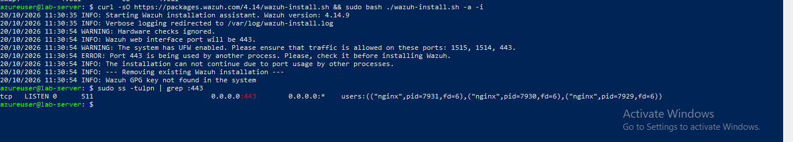<br>
  <em>Exhibit 5 — Installer error and `ss` output showing nginx listening on 443</em>
</p>

### Step 6 — Install fails with "No space left on device" ✅

On the second run the indexer, manager and filebeat installed, but the dashboard failed and the installer rolled everything back. The log showed `No space left on device`: the 30 GiB OS disk was too small.

<p align="center">
  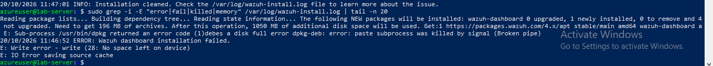<br>
  <em>Exhibit 6 — Installer log excerpt showing the disk-full write error</em>
</p>

### Step 7 — Resize the OS disk to 64 GiB ✅

The VM was stopped (deallocated), the OS disk was resized from 30 GiB to 64 GiB (P6) in the Azure portal, and the VM was started again. `df -h /` then showed about 61 GB total.

<p align="center">
  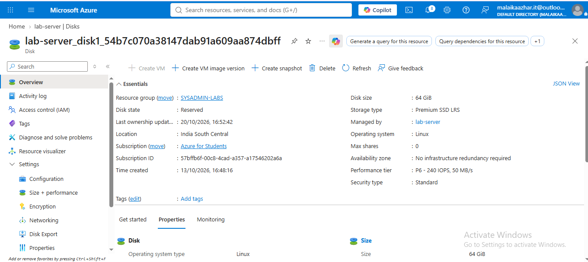<br>
  <em>Exhibit 7 — Azure disk page: size 64 GiB, performance tier P6</em>
</p>

### Step 8 — Clean up a half-installed package ✅

Re-running the installer failed with `Wazuh manager already installed`. Using `-o` (overwrite) then failed because the broken `wazuh-manager` package could not be removed. The fix was to move its failing `prerm` and `postrm` maintainer scripts aside and run `dpkg --purge --force-all`, then remove leftover directories and reinstall.

<p align="center">
  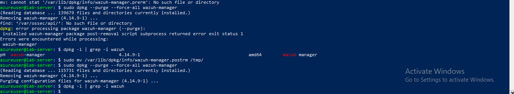<br>
  <em>Exhibit 8 — `dpkg --purge --force-all wazuh-manager` completing after the maintainer scripts were moved</em>
</p>

### Step 9 — Install completes ✅

The next run finished: indexer, manager, filebeat and dashboard all started. The generated admin credentials are not shown in this report.

<p align="center">
  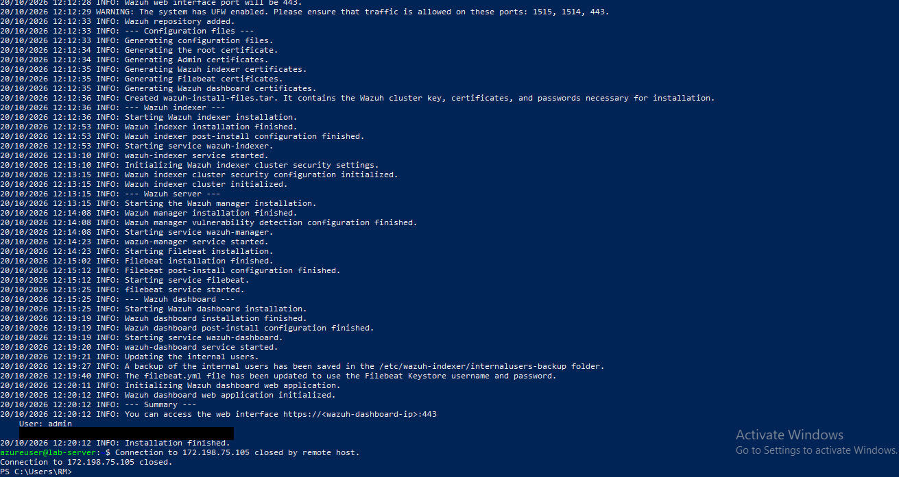<br>
  <em>Exhibit 9 — "Installation finished" with credentials redacted</em>
</p>

### Step 10 — Host firewall (UFW) for agent ports ✅

UFW was active and allowed only 22, 80 and 443. Ports 1514/tcp and 1515/tcp were added so the agent could register.

<p align="center">
  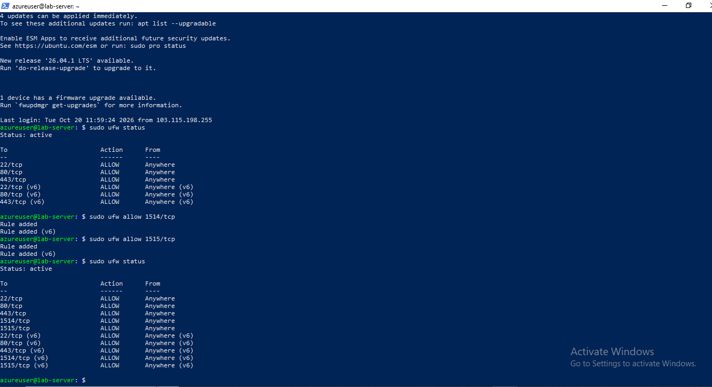<br>
  <em>Exhibit 10 — `ufw status` listing 1514 and 1515 (IPv4 and IPv6) after the rules were added</em>
</p>

### Step 11 — Dashboard login ✅

The dashboard opened at `https://<VM-Public-IP>` after accepting the self-signed certificate warning. The first login failed, so the `admin` password was reset on the server with Wazuh's password tool and login then worked.

<p align="center">
  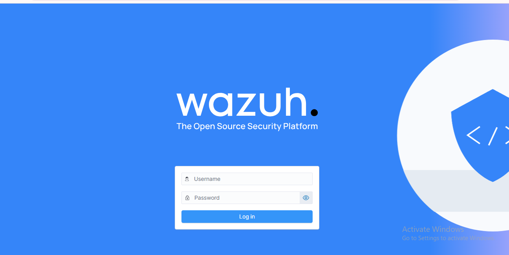<br>
  <em>Exhibit 11 — Wazuh dashboard login page served from the Azure VM</em>
</p>

<p align="center">
  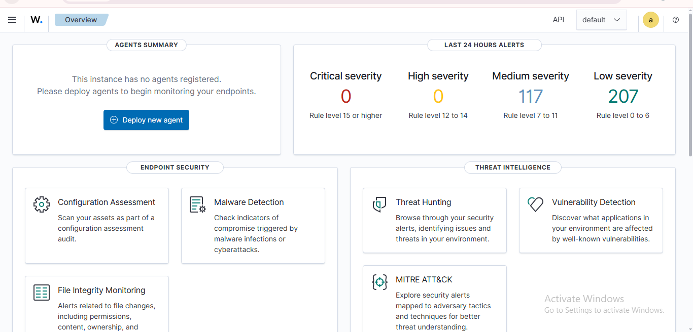<br>
  <em>Exhibit 12 — Overview page right after login: no agents registered yet</em>
</p>

---

<a id="module-3"></a>
## 🟢 Module 3 — Endpoint Agent and Alert Generation

**Objective:** Connect the Windows laptop and produce failed-login alerts to visualize.

### Step 13 — Install the Windows agent ✅

From the dashboard's "Deploy new agent" page (Windows, MSI, server address set to the VM), the generated PowerShell command was run in an Administrator window, followed by `NET START WazuhSvc`.

<p align="center">
  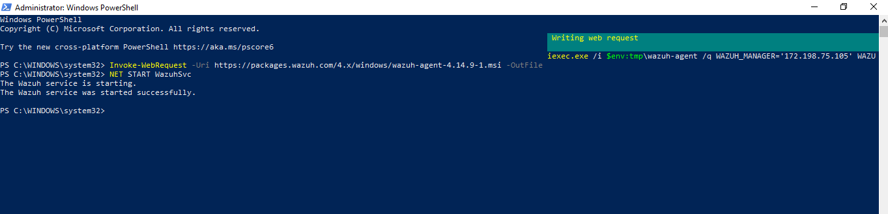<br>
  <em>Exhibit 13 — Agent MSI installed and "The Wazuh service was started successfully"</em>
</p>

### Step 14 — Agent shows Active ✅

<p align="center">
  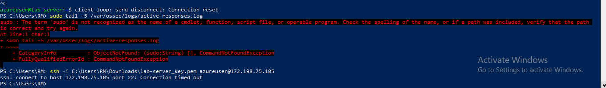<br>
  <em>Exhibit 14 — Endpoints page: `malaika-laptop`, Windows 10 Pro, v4.14.9, status active</em>
</p>

### Step 15 — Simulate failed logins ✅

From the laptop, repeated SSH attempts were made against my own VM with a user name that does not exist (`ssh fakeuser@<VM-Public-IP>`). Each returned `Permission denied (publickey)`.

<p align="center">
  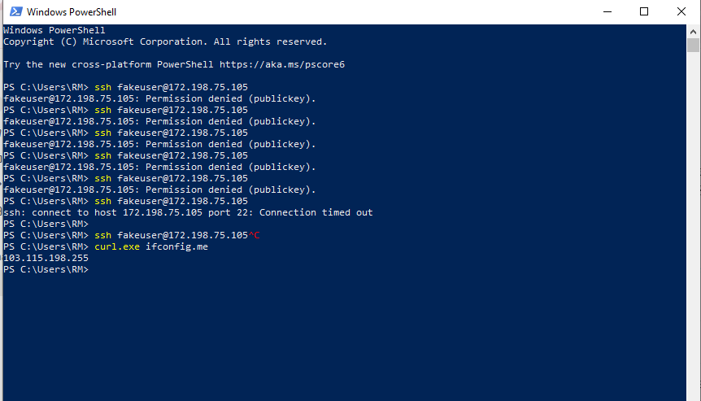<br>
  <em>Exhibit 15 — Repeated failed SSH attempts as `fakeuser` from the laptop</em>
</p>

### Step 16 — The alert Wazuh produced ✅

While SSH from the laptop was timing out, the Azure portal's Run Command feature was used to read the alert log on the VM. It shows rule 5710 ("sshd: Attempt to login using a non-existent user", level 5), mapped to MITRE ATT&CK Credential Access.

<p align="center">
  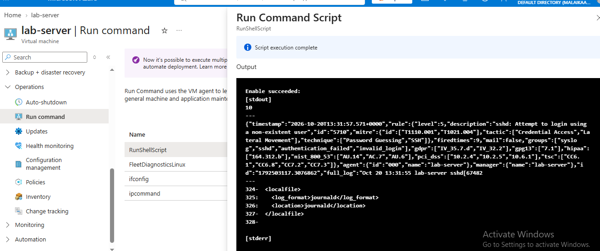<br>
  <em>Exhibit 16 — Alert JSON: rule 5710, MITRE T1110.001 / T1021.004, agent `lab-server`</em>
</p>

---

<a id="module-4"></a>
## 🟣 Module 4 — Visualization and Dashboard

**Objective:** Turn the alerts into a chart of top source IPs.

### Step 17 — Find the alerts in Discover ✅

A query on `data.srcip` returned 11 hits for my own public IP, with `data.dstuser: fakeuser` on each. Earlier searches showed no results because the laptop's clock was about 12 hours behind (taskbar read 9:36 AM during the evening), so the browser's "now" sat before the newest alerts. Widening the time range to the last 90 days fixed it.

<p align="center">
  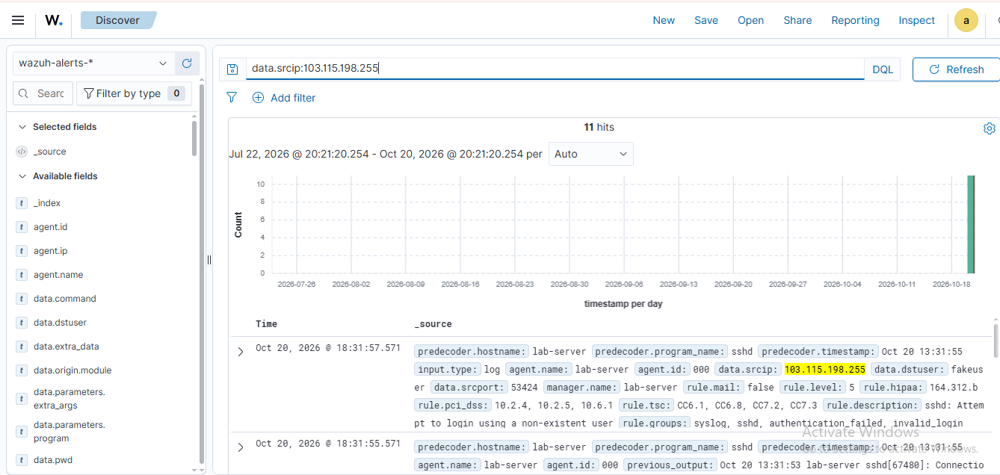<br>
  <em>Exhibit 17 — Discover: `data.srcip` query with 11 hits</em>
</p>

### Step 18 — Check the index directly ✅

Dev Tools confirmed the data was in the index: `wazuh-alerts-4.x-2026.10.20` held 770 documents, and a `match_phrase` query on `data.srcuser: fakeuser` returned 5 hits.

<p align="center">
  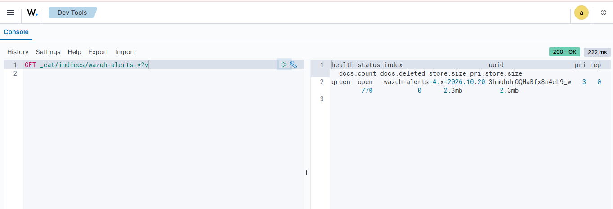<br>
  <em>Exhibit 18 — Dev Tools: index document count and a `fakeuser` search</em>
</p>

### Step 19 — Build the pie chart ✅

Visualize → pie, index `wazuh-alerts-*`, metric Count, bucket Split slices → Terms on `data.srcip`, descending by Count, size 5. Saved as **Top Attacker IPs**.

<p align="center">
  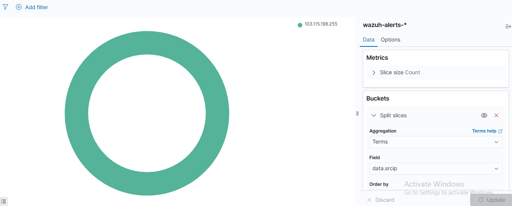<br>
  <em>Exhibit 19 — Visualization editor: Terms aggregation on `data.srcip`</em>
</p>

### Step 20 — Add it to a dashboard ✅

The saved visualization was added to a new dashboard, **Failed Login Monitoring**, with the time range set to 90 days.

<p align="center">
  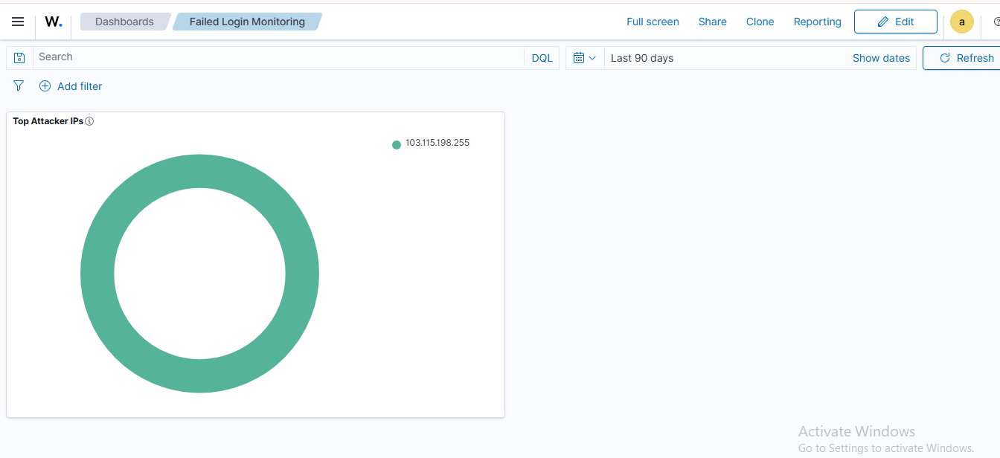<br>
  <em>Exhibit 20 — Saved dashboard showing the Top Attacker IPs chart</em>
</p>

### Step 21 — Final firewall state ✅

<p align="center">
  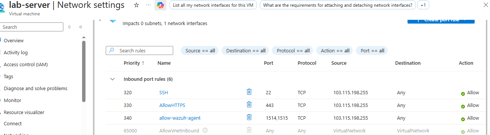<br>
  <em>Exhibit 21 — NSG: only 22 and 443 from my IP plus agent ports; the HTTP rule was removed</em>
</p>

### Step 22 — Stop the VM to save credits ✅

<p align="center">
  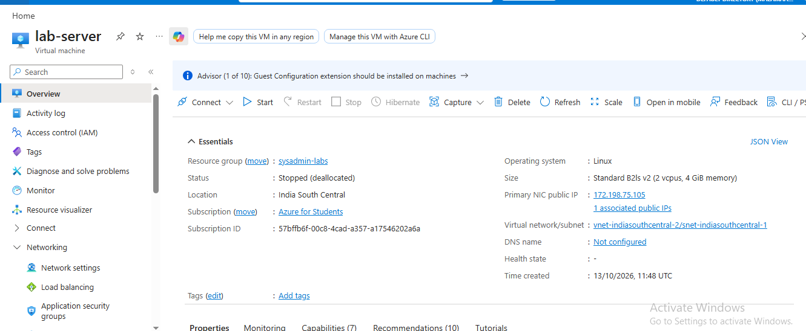<br>
  <em>Exhibit 22 — `lab-server` status: Stopped (deallocated)</em>
</p>

---

<a id="coverage-snapshot"></a>
## 🌟 Coverage Snapshot

| 🛡️ Area | ✅ Status | 📌 Detail |
|---|---|---|
| SIEM Deployment | Complete | Wazuh 4.14.9 all-in-one on Azure, three services running |
| Endpoint Onboarding | Complete | One Windows agent, status active |
| Alert Generation | Complete, simulated | Failed SSH logins from my own IP, rule 5710 |
| Visualization | Complete | Terms aggregation on `data.srcip`, saved to a dashboard |
| Automation / Export | Not attempted | No API or CSV/JSON export pipeline built |

### 🧾 What the Evidence Proves

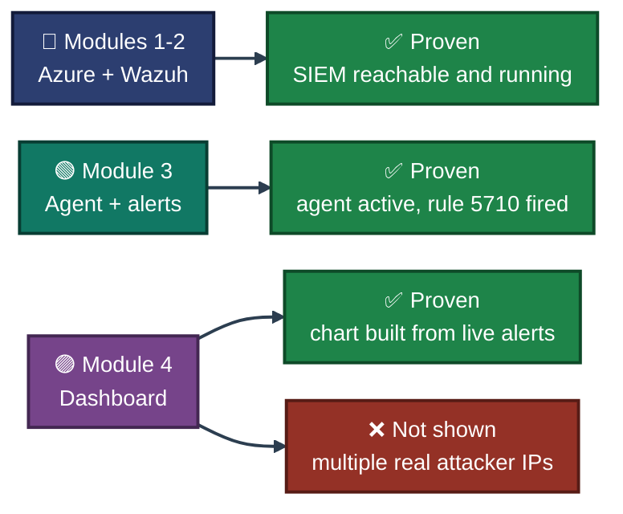

---

<a id="troubleshooting-pipeline"></a>
## 🧭 Troubleshooting Pipeline

How each failure in this build was isolated and fixed

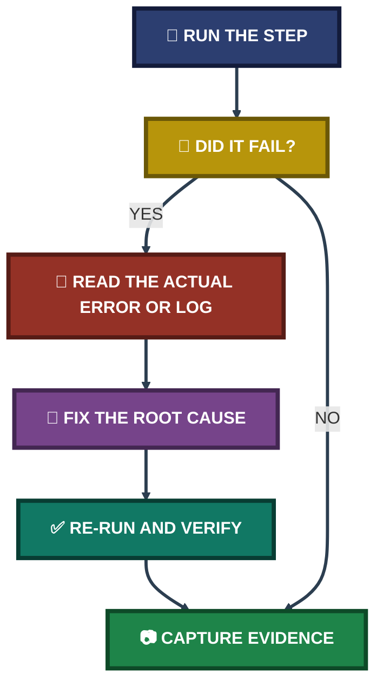

---

<a id="command-reference"></a>
## 🧰 Command Reference

| # | Command | Used In | Purpose |
|:---:|---|---|---|
| 1 | `ssh -i <key>.pem azureuser@<VM-Public-IP>` | Module 1 | Connect to the VM |
| 2 | `sudo fallocate -l 4G /swapfile` then `chmod 600`, `mkswap`, `swapon` | Module 1 | Create and enable a 4 GB swap file |
| 3 | `echo '/swapfile none swap sw 0 0' \| sudo tee -a /etc/fstab` | Module 1 | Keep swap across reboots |
| 4 | `sudo ss -tulpn \| grep :443` | Module 2 | Find what is using port 443 |
| 5 | `sudo systemctl stop nginx` / `disable nginx` | Module 2 | Free port 443 for the Wazuh dashboard |
| 6 | `curl -sO https://packages.wazuh.com/4.14/wazuh-install.sh && sudo bash ./wazuh-install.sh -a -i` | Module 2 | Wazuh all-in-one install, hardware check skipped |
| 7 | `sudo bash ./wazuh-install.sh -a -i -o` | Module 2 | Reinstall over a previous attempt |
| 8 | `sudo dpkg --purge --force-all wazuh-manager` | Module 2 | Remove the broken package |
| 9 | `sudo ufw allow 1514/tcp` and `1515/tcp` | Module 2 | Open agent ports on the host firewall |
| 10 | `sudo bash wazuh-passwords-tool.sh -u admin -p '<new-password>'` | Module 2 | Reset the dashboard admin password |
| 11 | `NET START WazuhSvc` | Module 3 | Start the Windows agent service |
| 12 | `ssh fakeuser@<VM-Public-IP>` | Module 3 | Produce failed-login events |
| 13 | `data.srcip:<IP>` (DQL) | Module 4 | Find alerts for a source IP in Discover |
| 14 | `GET _cat/indices/wazuh-alerts-*?v` | Module 4 | Confirm alert documents exist in the index |

---

<a id="project-summary"></a>
## 📝 Project Summary

| Module | Tooling | Key Outcome |
|---|---|---|
| Module 1 — Azure VM and Network | Azure portal, NSG, SSH | VM reachable, ports limited to what the lab needs, swap added |
| Module 2 — Wazuh Install and Recovery | Wazuh installer, dpkg, UFW | Three failed attempts diagnosed, stack installed and dashboard live |
| Module 3 — Agent and Alerts | Wazuh agent, PowerShell, SSH | Agent active, rule 5710 alerts generated from simulated failed logins |
| Module 4 — Visualization | Discover, Dev Tools, Visualize | Top Attacker IPs chart saved to the Failed Login Monitoring dashboard |

---

<a id="challenges-fixes"></a>
## ⚠️ Challenges & Fixes

| ❌ Challenge | ✅ Fix |
|---|---|
| Placeholder SSH key path gave `Permission denied (publickey)` | Located the real `.pem` file with `dir *.pem` and used its actual path |
| Pasting several lines at once mixed up the swap commands | Ran the commands one line at a time and verified with `free -h` |
| Installer stopped: port 443 already in use | Identified nginx with `ss -tulpn`, stopped and disabled it |
| Dashboard install failed with `No space left on device` | Resized the OS disk from 30 GiB to 64 GiB and verified with `df -h` |
| Reinstall blocked by a broken `wazuh-manager` package | Moved the failing `prerm`/`postrm` scripts aside and purged with `--force-all`, then removed leftover directories |
| Laptop went to sleep and dropped the SSH session during install | Changed Windows sleep settings and reconnected |
| Console output froze (window title showed "Select") | Pressed Esc to leave text-selection mode; output resumed |
| Dashboard login rejected the generated password | Reset the `admin` password with the Wazuh password tool and logged in |
| Discover showed no results for "Last 7 days" | Laptop clock was ~12 hours behind; used a 90-day range, which showed the alerts |
| Windows `Set-Date` returned "A required privilege is not held" | The shell was not elevated, so the clock change was not applied from that window |
| SSH from the laptop began timing out after many failed attempts | Cause not confirmed; used Azure Run Command to inspect the VM instead |

---

<a id="scope-limitations"></a>
## 🚧 Scope & Limitations

- **Simulated activity, not real attackers:** All failed logins came from my own laptop against my own VM. The chart therefore has one slice (my own IP). It shows that the pipeline works, not that real attacker IPs were observed.
- **Alerts came from the VM's own SSH log:** Rule 5710 fired on `lab-server` (the manager host, agent 000). The Windows agent was connected and sending events, but no failed-login alerts from Windows are shown in this report.
- **Undersized host:** 4 GiB RAM with a swap file and the installer's hardware check skipped (`-i`). Fine for a one-agent lab, not representative of a production deployment.
- **Manual workflow:** The dashboard and visualization were built by hand in the UI. No API calls, scheduled reports, or CSV/JSON export pipeline were built in this project.
- **Self-signed certificate:** The browser warning was accepted for this lab only.
- **Intermittent SSH timeouts:** After repeated failed SSH attempts, connections from the laptop timed out for a while. The cause was not confirmed.
- **Password reset:** The first login failed and the admin password was reset on the server. Whether the original password was mistyped was not confirmed.
- **Credentials:** Screenshots that showed generated passwords are redacted or excluded from this repository.

These gaps are stated directly instead of hidden, so the results reflect what was actually built and verified.

---

<a id="what-i-learned"></a>
## 🧠 What I Learned

- **Read the log before guessing.** The disk-full failure was only obvious in the installer log, not in the on-screen messages.
- **Free the host's resources first.** A pre-installed web server on 443 and a 30 GiB disk each blocked the install in a different way.
- **A broken package can be removed safely once you know which scripts fail.** Understanding `dpkg` maintainer scripts turned a stuck install into a clean reinstall.
- **Clock and time range matter in a SIEM.** A wrong system clock made valid data look missing.
- **Restricting access is cheap.** Limiting SSH and HTTPS to one source IP at the NSG takes a minute and removes most internet exposure.

---

<a id="skills-demonstrated"></a>
## 🛠️ Skills Demonstrated

- Deploying and securing a Linux VM in Azure (NSG rules, disk resize, deallocation to save credits)
- Installing and troubleshooting a Wazuh all-in-one stack (port conflicts, disk space, broken dpkg state)
- Onboarding a Windows endpoint with the Wazuh agent
- Searching alerts with DQL and the OpenSearch Dev Tools console
- Building a Terms-aggregation visualization and saving it to a dashboard
- Writing a transparent report that states what the evidence does and does not prove

---

<a id="screenshot-index"></a>
## 🖼️ Screenshot Index

| # | File | Shows |
|:---:|---|---|
| 1 | `ss-01-azure-vm-overview.PNG` | Azure VM overview: Running, Ubuntu 24.04, 4 GiB RAM |
| 2 | `ss-02-nsg-inbound-rules.PNG` | NSG rules with SSH/HTTPS restricted and agent ports open |
| 3 | `ss-03-ssh-connected.PNG` | Successful SSH login |
| 4 | `ss-04-swap-enabled.PNG` | `free -h` with 4.0Gi swap |
| 5 | `ss-05-install-blocked-port-443-nginx.PNG` | Installer error and nginx on port 443 |
| 6 | `ss-06-install-failed-no-space-left.PNG` | Log excerpt: No space left on device |
| 7 | `ss-07-os-disk-resized-64gib.PNG` | Azure disk resized to 64 GiB |
| 8 | `ss-08-broken-package-purge.PNG` | Purging the broken `wazuh-manager` package |
| 9 | `ss-09-wazuh-install-finished.PNG` | Installation finished (credentials redacted) |
| 10 | `ss-10-ufw-agent-ports.PNG` | UFW rules for 1514 and 1515 |
| 11 | `ss-11-wazuh-login-page.PNG` | Wazuh dashboard login page |
| 12 | `ss-12-dashboard-no-agents.PNG` | Overview before any agent registered |
| 13 | `ss-13-agent-install-powershell.PNG` | Agent install and service start on Windows |
| 14 | `ss-14-endpoint-agent-active.PNG` | Endpoints page with `malaika-laptop` active |
| 15 | `ss-15-simulated-failed-ssh.PNG` | Failed SSH attempts as `fakeuser` |
| 16 | `ss-16-rule-5710-alert-run-command.PNG` | Rule 5710 alert JSON via Azure Run Command |
| 17 | `ss-17-discover-srcip-hits.PNG` | Discover: `data.srcip` query, 11 hits |
| 18 | `ss-18-devtools-index-check.PNG` | Dev Tools: index count and `fakeuser` search |
| 19 | `ss-19-top-attacker-ips-visualization.PNG` | Visualization editor with Terms on `data.srcip` |
| 20 | `ss-20-failed-login-monitoring-dashboard.PNG` | Saved Failed Login Monitoring dashboard |
| 21 | `ss-21-nsg-restricted-final.PNG` | Final NSG rules |
| 22 | `ss-22-vm-deallocated.PNG` | VM Stopped (deallocated) |

---

<a id="repo-structure"></a>
## 📁 Repo Structure

```text
project-19-siem-dashboard-azure/
|-- README.md
|-- INDEX.md
`-- screenshots/
    |-- ss-01-azure-vm-overview.PNG
    |-- ss-02-nsg-inbound-rules.PNG
    |-- ss-03-ssh-connected.PNG
    |-- ss-04-swap-enabled.PNG
    |-- ss-05-install-blocked-port-443-nginx.PNG
    |-- ss-06-install-failed-no-space-left.PNG
    |-- ss-07-os-disk-resized-64gib.PNG
    |-- ss-08-broken-package-purge.PNG
    |-- ss-09-wazuh-install-finished.PNG
    |-- ss-10-ufw-agent-ports.PNG
    |-- ss-11-wazuh-login-page.PNG
    |-- ss-12-dashboard-no-agents.PNG
    |-- ss-13-agent-install-powershell.PNG
    |-- ss-14-endpoint-agent-active.PNG
    |-- ss-15-simulated-failed-ssh.PNG
    |-- ss-16-rule-5710-alert-run-command.PNG
    |-- ss-17-discover-srcip-hits.PNG
    |-- ss-18-devtools-index-check.PNG
    |-- ss-19-top-attacker-ips-visualization.PNG
    |-- ss-20-failed-login-monitoring-dashboard.PNG
    |-- ss-21-nsg-restricted-final.PNG
    `-- ss-22-vm-deallocated.PNG
```

<div align="center">

🛡️ **[Wazuh](https://wazuh.com)** · ☁️ **[Microsoft Azure](https://azure.microsoft.com)** · 🐧 **[Ubuntu Server](https://ubuntu.com/server)** · 🧭 **[Troubleshooting Pipeline](#troubleshooting-pipeline)**

</div>
