<div align="center">

# 🛡️ Windows Brute Force Detection with Wazuh

**Project 20 of 20 — Blue Team Defense Projects**

Wazuh SIEM Deployment · Windows Agent Enrollment · Failed-Logon Detection (MITRE T1110)


A Wazuh server on an Azure VM, a Windows 10 endpoint enrolled as an agent, a simulated brute force against a local test account, and the 12 resulting high-severity alerts found, saved and exported. Every failure on the way (existing install, Filebeat error, agent version mismatch) is recorded with its fix.

### [📑 Open the visual index](INDEX.md)

</div>

---

## 📑 Table of Contents

1. [At a Glance](#at-a-glance)
2. [Project Background](#project-background)
3. [Environment](#environment)
4. [Project Flow](#project-flow)
5. [Module 1 — Wazuh Server Deployment](#module-1)
6. [Module 2 — Windows Agent Enrollment](#module-2)
7. [Module 3 — Brute Force Simulation and Detection](#module-3)
8. [Coverage Snapshot](#coverage-snapshot)
9. [Troubleshooting Pipeline](#troubleshooting-pipeline)
10. [Command Reference](#command-reference)
11. [Project Summary](#project-summary)
12. [Challenges & Fixes](#challenges-fixes)
13. [Scope & Limitations](#scope-limitations)
14. [What I Learned](#what-i-learned)
15. [Skills Demonstrated](#skills-demonstrated)
16. [Screenshot Index](#screenshot-index)
17. [Repo Structure](#repo-structure)

---

<a id="at-a-glance"></a>
## 📊 At a Glance

| 🖥️ Systems | 🧩 Modules | 🖼️ Screenshots | 🚨 Alerts Detected |
|:---:|:---:|:---:|:---:|
| **2** | **3** | **25** | **12** |

---

<a id="project-background"></a>
## 📖 Project Background

This project closes the series by putting a SIEM to work on a realistic detection case: a burst of failed Windows logons. It covers three things end to end: deploying Wazuh, enrolling a Windows endpoint, and proving that Wazuh raises a brute-force alert when failed logons are generated on purpose.

| Plan Item | What Was Built |
|---|---|
| Wazuh server | One Ubuntu 24.04.5 VM in Azure (`lab-server`), all-in-one install: manager, indexer, Filebeat, dashboard (4.9.2) |
| Endpoint | Windows 10 Pro machine, agent `malaika-win01`, agent version matched to the manager (4.9.2) |
| Attack simulation | Repeated failed logons with wrong passwords against a local test account, using `net use` against `127.0.0.1` |
| Detection | Wazuh rule 60204 *Multiple Windows Logon Failures*, level 10, MITRE T1110 |

> [!NOTE]
> The attack was run from the endpoint against itself (loopback), so the source IP in every alert is `127.0.0.1`. This proves the detection pipeline works. It does not model an attacker on another host.

<div align="center">

### 🧩 Lab Setup at a Glance

<table>
<tr>
<td align="center" valign="top" width="42%">


**Agent `malaika-win01`**<br>
<sub>192.168.100.38<br>Wazuh agent 4.9.2</sub>

</td>
<td align="center" valign="middle" width="16%">

**➜**<br>
<sub>1514/tcp events<br>1515 enrollment</sub>

</td>
<td align="center" valign="top" width="42%">


**Manager / Indexer / Dashboard**<br>
<sub>Azure VM `lab-server`<br>Ubuntu 24.04.5 LTS</sub>

</td>
</tr>
</table>

</div>

---

<a id="environment"></a>
## 🖧 Environment

| Item | Value |
|---|---|
| **Server** | Azure VM `lab-server`, Ubuntu 24.04.5 LTS, about 3.8 GiB RAM, 4 GiB swap, 60.95 GB disk |
| **Server addresses** | Private `172.16.0.4`, reached at `172.198.75.105` |
| **SIEM** | Wazuh 4.9.2 (Manager + Indexer + Filebeat + Dashboard), cluster node `node01` |
| **Endpoint** | Windows 10 Pro `10.0.19045.7725`, hostname `DESKTOP-62ETFNM` |
| **Agent** | ID `001`, name `malaika-win01`, IP `192.168.100.38`, version 4.9.2, group `default` |
| **Test account** | Local user `wazuhtest` (created for the simulation) |
| **Time zones** | Server and alert timestamps are UTC. The dashboard and the Windows log show local time, UTC+5 |

> [!IMPORTANT]
> The dashboard shows the alerts at 23:23–23:29. In UTC (as stored in the JSON export) they are 18:23–18:29. Both refer to the same events.

### 🗺️ Lab Topology


<p align="center"><em>The simulated attack runs on the endpoint itself; the agent forwards the resulting Security events to the Azure-hosted Wazuh manager.</em></p>

---

<a id="project-flow"></a>
## ⏱️ Project Flow

```mermaid
%%{init: { 'theme': 'base', 'themeVariables': {
  'doneTaskBkgColor':'#117864', 'doneTaskBorderColor':'#083D33',
  'sectionBkgColor':'#D6DBDF', 'altSectionBkgColor':'#EAECEE',
  'taskTextColor':'#FFFFFF', 'taskTextOutsideColor':'#1B2631',
  'taskTextLightColor':'#FFFFFF',
  'titleColor':'#1B2A4A', 'fontSize':'18px'
}}}%%
gantt
    title Project Flow — Three Modules (2026-10-20, UTC)
    dateFormat HH:mm
    axisFormat %H:%M
    section Server
    Module 1 - Wazuh reinstall on Azure                  :done, 17:02, 20m
    section Endpoint
    Module 2 - Agent troubleshooting and reinstall        :done, 17:49, 23m
    section Detection
    Module 3 - Failed-logon simulation                    :done, 18:23, 7m
    Module 3 - Search, export and inspect                 :done, 18:51, 8m
```
<p align="center"><em>Times come from the log and file timestamps (UTC). Bars show the span of each activity, not exact start and stop of every step.</em></p>

---

<a id="module-1"></a>
## 🔵 Module 1 — Wazuh Server Deployment

**Objective:** Get a working Wazuh server on the Azure VM, recovering from an existing install and a failed first reinstall.

### Step 1 — Reach the server over SSH ✅

The Wazuh server is an Ubuntu VM in Azure (`lab-server`). The first attempt used a placeholder hostname (`<VM-IP>`) and could not resolve it. The second attempt, without a key, was refused with `Permission denied (publickey)`.

<p align="center">
  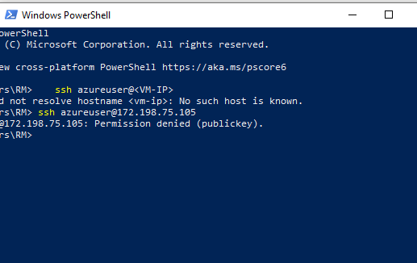<br>
  <em>Exhibit 1 — SSH to the Azure VM: placeholder hostname fails, password-less SSH is refused with <code>Permission denied (publickey)</code></em>
</p>


### Step 2 — Log in with the key file ✅

Connecting with `ssh -i ...\lab-server_key.pem azureuser@172.198.75.105` worked. The login banner confirms Ubuntu 24.04.5 LTS on an Azure kernel, a 60.95 GB root disk and private address `172.16.0.4`.

<p align="center">
  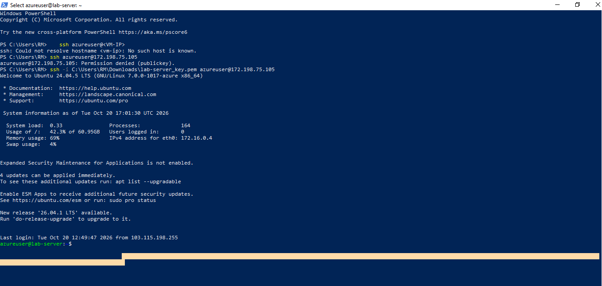<br>
  <em>Exhibit 2 — SSH with the key file succeeds: Ubuntu 24.04.5 LTS on the Azure VM <code>lab-server</code></em>
</p>


### Step 3 — Installer finds an existing install ✅

`free -h` shows 3.8 GiB RAM. Running `wazuh-install.sh -a` stopped with "already installed" for the manager, indexer, dashboard and Filebeat, and suggested the `-o` overwrite option. `systemctl status` showed all three services active (running), and they were restarted.

<p align="center">
  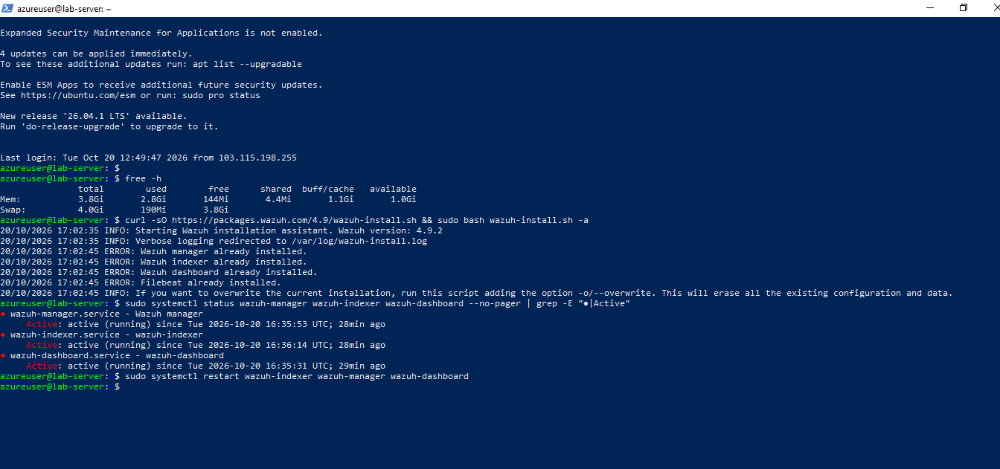<br>
  <em>Exhibit 3 — Installer reports Wazuh already installed; manager, indexer and dashboard show active (running), then are restarted</em>
</p>


### Step 4 — Credentials archive missing, password tool rejected, overwrite chosen ✅

`wazuh-install-files.tar` could not be found, so the generated passwords could not be read back. The passwords tool then rejected a new password because it did not meet the policy (8–64 characters with upper and lower case, a number and a symbol). The installer was re-run with `-a -o`, which starts by removing the existing installation. The password typed in this capture is blacked out.

<p align="center">
  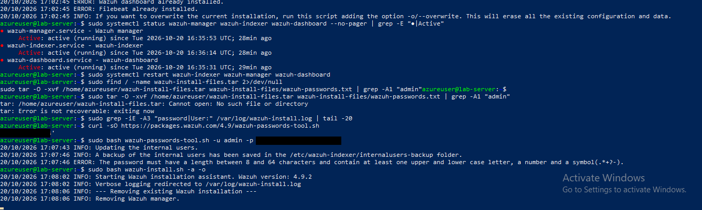<br>
  <em>Exhibit 4 — Credentials archive not found, password tool rejects a weak password, installer re-run with <code>-a -o</code> (credentials redacted)</em>
</p>


### Step 5 — First reinstall fails at Filebeat ✅

The overwrite reinstall ran from 17:08 and failed at 17:11:18 with `ERROR: filebeat could not be started`. The script then removed the installation again ("Installation cleaned", 17:12:45).

<p align="center">
  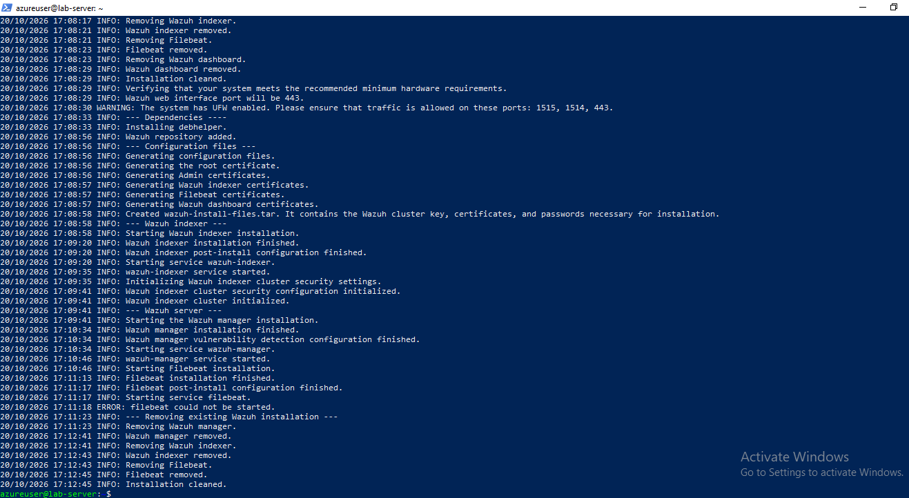<br>
  <em>Exhibit 5 — First clean reinstall fails with <code>filebeat could not be started</code> and is removed again</em>
</p>


### Step 6 — Second reinstall completes ✅

A second run, started at 17:14:41, finished at 17:21:36 with `Installation finished`. The installer also warned that UFW is enabled and ports 1515, 1514 and 443 must be allowed. The generated admin password in this capture is blacked out.

<p align="center">
  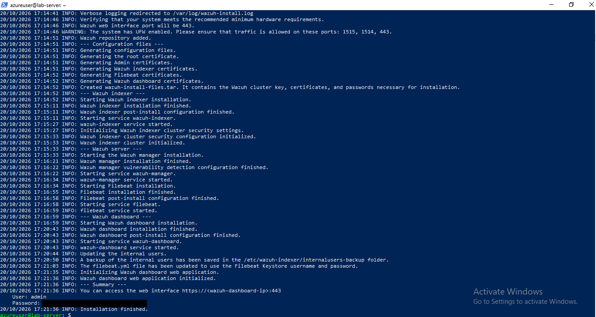<br>
  <em>Exhibit 6 — Second reinstall completes: <code>Installation finished</code> (credentials redacted)</em>
</p>


### Step 7 — Dashboard login attempt rejected ✅

Opening `https://172.198.75.105/app/login` and signing in as `admin` returned `Invalid username or password. Please try again.` The next step re-reads the credentials from the install archive.

<p align="center">
  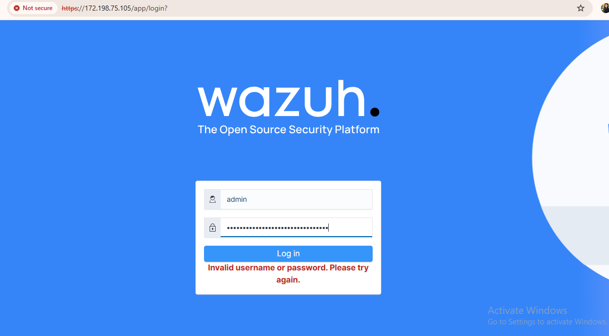<br>
  <em>Exhibit 7 — Dashboard login refused: <code>Invalid username or password</code></em>
</p>


### Step 8 — Read the credentials from the install archive ✅

`tar -O -xvf ~/wazuh-install-files.tar wazuh-install-files/wazuh-passwords.txt | grep -A1 "admin"` listed the `admin` and `anomalyadmin` indexer users. Both passwords are blacked out. The dashboard login worked afterwards, as the later dashboard screenshots show.

<p align="center">
  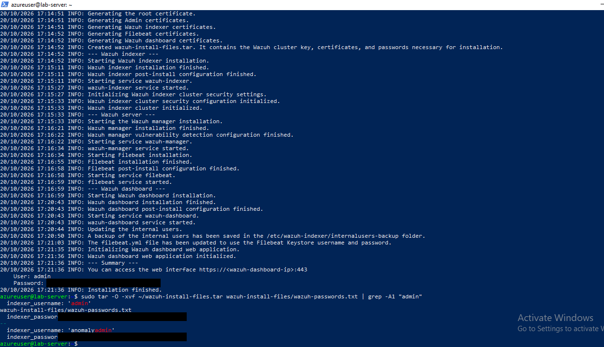<br>
  <em>Exhibit 8 — Admin credentials re-read from the install archive with <code>tar</code> and <code>grep</code> (credentials redacted)</em>
</p>


---

<a id="module-2"></a>
## 🟠 Module 2 — Windows Agent Enrollment

**Objective:** Enroll the Windows 10 endpoint as agent `malaika-win01`, fixing the version mismatch that blocked registration.

### Step 9 — Install the Windows agent ✅

On the Windows 10 endpoint, an elevated PowerShell session downloaded the Wazuh agent MSI and installed it with `WAZUH_MANAGER='172.198.75.105'` and `WAZUH_AGENT_NAME='malaika-win01'`. `NET START WazuhSvc` answered that the service had already been started.

<p align="center">
  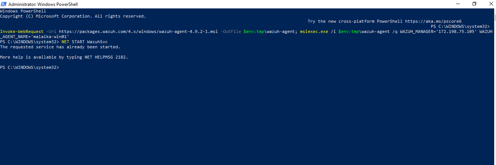<br>
  <em>Exhibit 9 — Agent install command run on Windows; <code>NET START WazuhSvc</code> reports the service is already started</em>
</p>


### Step 10 — Confirm the manager ports are reachable ✅

`Test-NetConnection 172.198.75.105 -Port 1514` and `-Port 1515` both returned `TcpTestSucceeded : True` from source address `192.168.100.38`, so the problem was not network reachability.

<p align="center">
  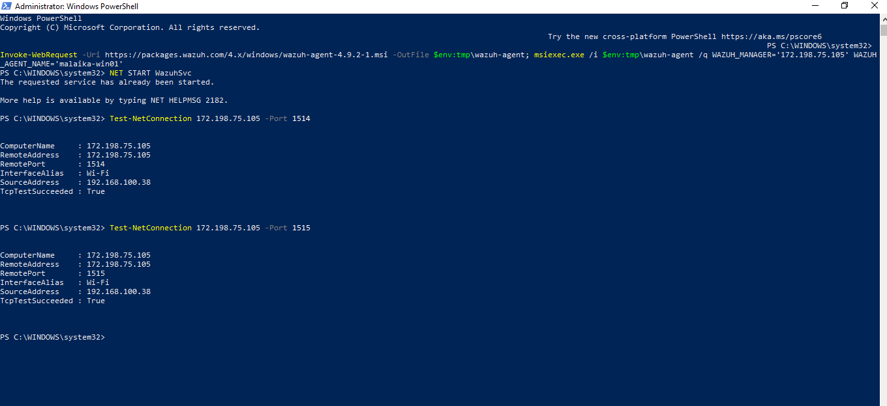<br>
  <em>Exhibit 10 — <code>Test-NetConnection</code> to the manager on ports 1514 and 1515: <code>TcpTestSucceeded : True</code></em>
</p>


### Step 11 — Diagnose why the agent will not register ✅

`ossec.log` showed the agent reaching the server and then failing: `Agent version must be lower or equal to manager version` and `Unable to add agent`. The log hint says the manager would need to be `v4.14.9` or higher, so the installed agent was newer than the 4.9.2 manager. In this capture the agent also used the name `malaika-laptop`, and `Get-Service WazuhSvc` found no service.

<p align="center">
  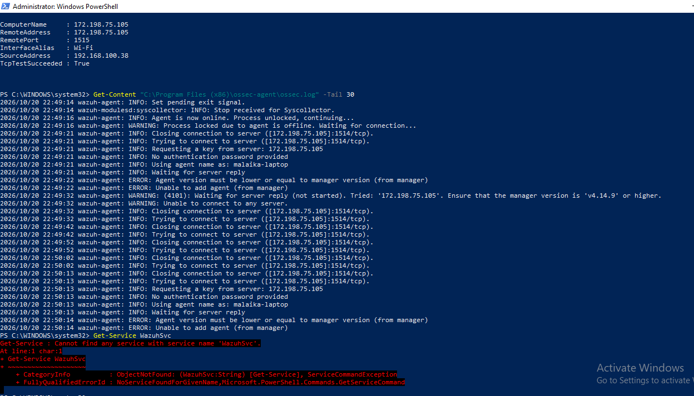<br>
  <em>Exhibit 11 — <code>ossec.log</code>: <code>Agent version must be lower or equal to manager version</code>; <code>WazuhSvc</code> not found</em>
</p>


### Step 12 — Uninstall the mismatched agent ✅

`Get-WmiObject -Class Win32_Product | Where-Object { $_.Name -like "*Wazuh*" } | ForEach-Object { $_.Uninstall() }` returned `ReturnValue : 0`, meaning the uninstall succeeded.

<p align="center">
  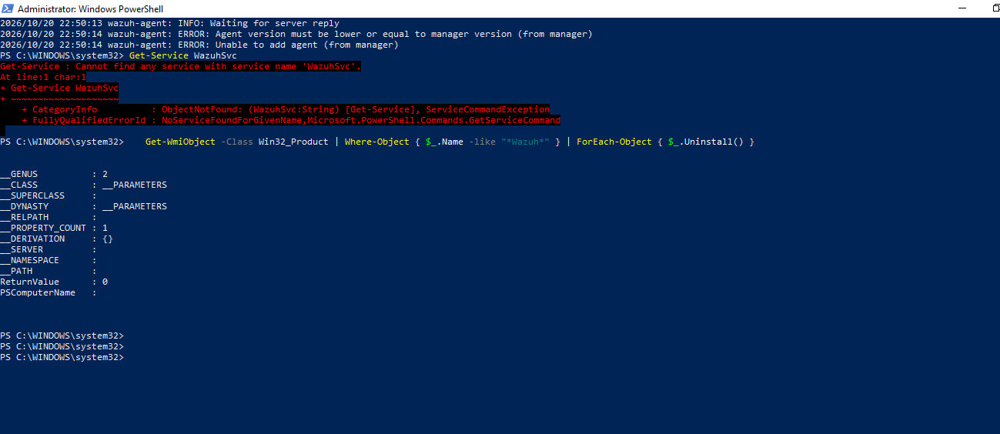<br>
  <em>Exhibit 12 — Wazuh agent uninstalled through <code>Win32_Product</code> (<code>ReturnValue : 0</code>)</em>
</p>


### Step 13 — Clean up and reinstall a matching version ✅

`Test-Path` confirmed the `ossec-agent` folder was left behind, and `Remove-Item -Recurse -Force` deleted it. The agent was then reinstalled from `wazuh-agent-4.9.2-1.msi`, the same version as the manager, with the manager address and the name `malaika-win01`.

<p align="center">
  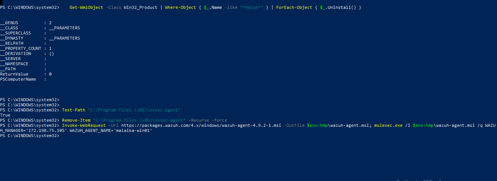<br>
  <em>Exhibit 13 — Leftover <code>ossec-agent</code> folder removed; agent 4.9.2 MSI downloaded and installed silently</em>
</p>


### Step 14 — Start the service ✅

`Get-Service WazuhSvc` showed `Stopped`. `NET START WazuhSvc` started it. Reading `ossec.log` straight away failed with "path does not exist", because the installation was still writing its files.

<p align="center">
  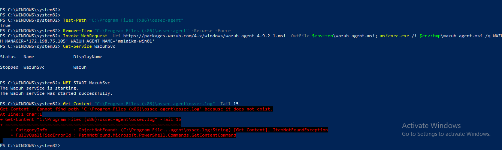<br>
  <em>Exhibit 14 — <code>WazuhSvc</code> was stopped, then started successfully; <code>ossec.log</code> not created yet</em>
</p>


### Step 15 — Verify the agent files are back ✅

`Get-ChildItem "C:\Program Files (x86)\ossec-agent"` now lists the expected files, including `ossec.conf`, `ossec.log`, `client.keys` and `wazuh-agent.exe`.

<p align="center">
  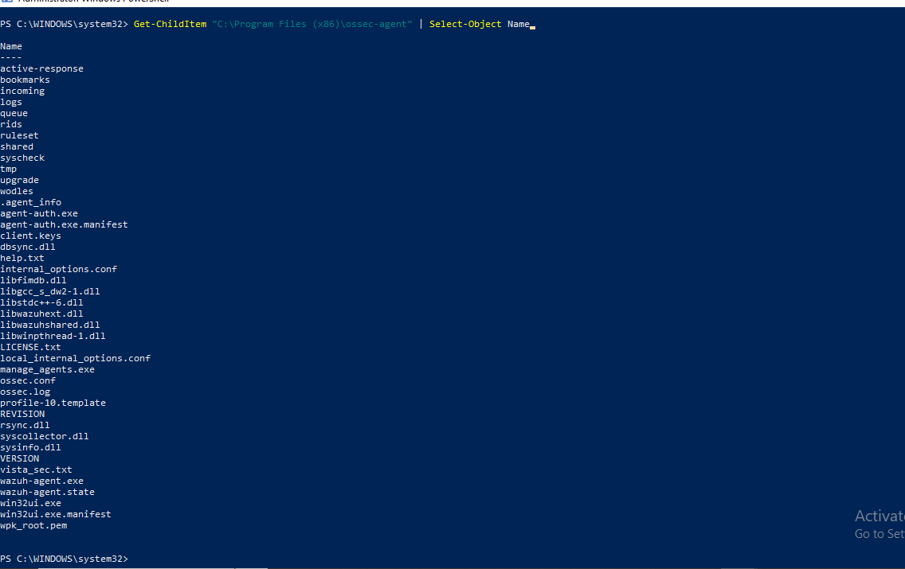<br>
  <em>Exhibit 15 — <code>ossec-agent</code> directory repopulated: <code>ossec.conf</code>, <code>ossec.log</code>, <code>client.keys</code>, <code>wazuh-agent.exe</code></em>
</p>


### Step 16 — Confirm the agent is active in the dashboard ✅

The Endpoints page lists one agent: ID `001`, name `malaika-win01`, IP `192.168.100.38`, Windows 10 Pro `10.0.19045.7725`, cluster node `node01`, version `v4.9.2`, status active.

<p align="center">
  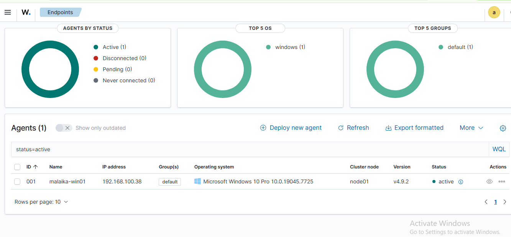<br>
  <em>Exhibit 16 — Endpoints page: agent <code>001 malaika-win01</code>, Windows 10 Pro, v4.9.2, status active</em>
</p>


---

<a id="module-3"></a>
## 🔴 Module 3 — Brute Force Simulation and Detection

**Objective:** Generate failed logons on purpose, find the resulting Wazuh alerts, save the search and export the evidence.

### Step 17 — Check the agent log and create a test account ✅

`ossec.log` shows the agent connected to `[172.198.75.105]:1514/tcp`, started, and "now online". A local account `wazuhtest` was then created with `net user wazuhtest "<password>" /add`; the password is blacked out.

<p align="center">
  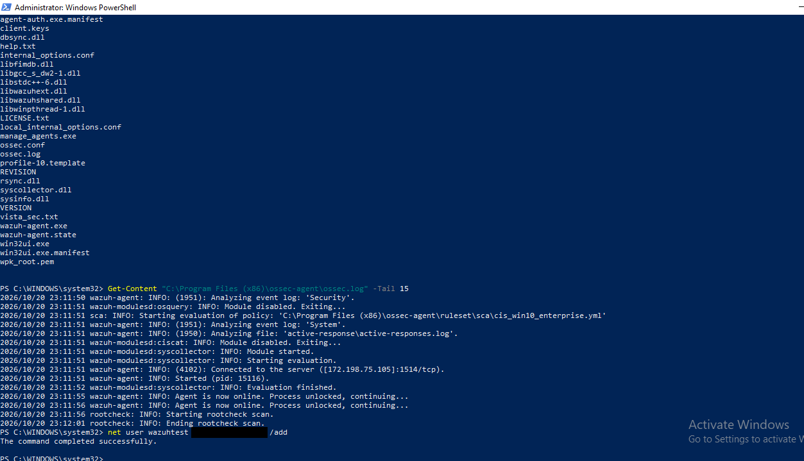<br>
  <em>Exhibit 17 — <code>ossec.log</code> shows the agent connected and online; local test user <code>wazuhtest</code> created (password redacted)</em>
</p>


### Step 18 — Simulate the brute force ✅

Ten wrong passwords per run were tried against the loopback IPC share, one second apart:

```powershell
1..10 | ForEach-Object { net use \\127.0.0.1\IPC$ /user:wazuhtest "wrong$_" 2>&1 | Out-Null; Start-Sleep -Seconds 1 }
```

The loop was repeated several times. Each failure is a Windows Security event 4625.

<p align="center">
  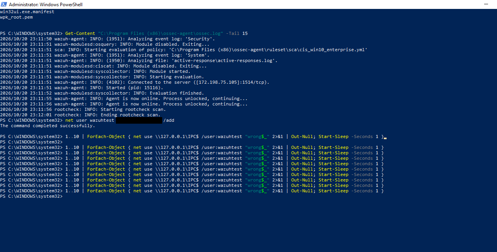<br>
  <em>Exhibit 18 — Failed-logon loop against <code>\\127.0.0.1\IPC$</code> with wrong passwords, run repeatedly (password redacted)</em>
</p>


### Step 19 — Find the agent's events in Discover ✅

Searching `agent.name:malaika-win01` over the last 24 hours returned 514 hits. That number mixes all agent events (configuration assessment, system events and the failed logons), so it is not the brute-force count. The expanded events show `ipAddress: 127.0.0.1`, `targetUserName: wazuhtest` and `authenticationPackageName: NTLM`.

<p align="center">
  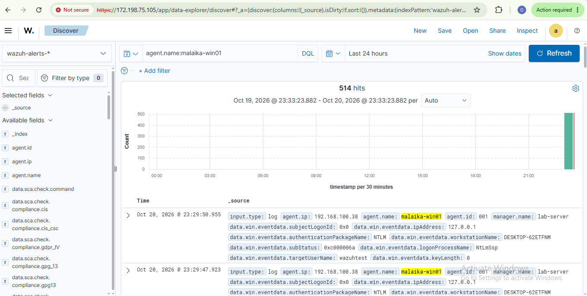<br>
  <em>Exhibit 19 — Discover, <code>agent.name:malaika-win01</code>, last 24 hours: 514 hits of all agent events</em>
</p>


### Step 20 — Filter to high-severity alerts ✅

Adding `and rule.level >= 10` reduced the result to 12 hits. In the `_source` view these are Windows Security `AUDIT_FAILURE` events for event ID 4625.

<p align="center">
  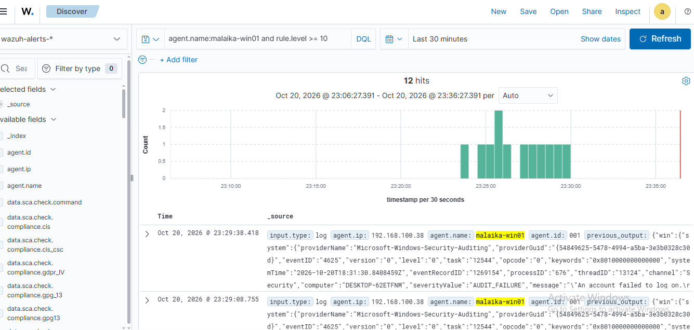<br>
  <em>Exhibit 20 — Discover with <code>rule.level &gt;= 10</code>: 12 hits, raw <code>_source</code> view</em>
</p>


#### What the 12 alerts contain (from the JSON export)

| Field | Value |
|---|---|
| `rule.id` / `rule.level` | `60204` / `10` |
| `rule.description` | Multiple Windows Logon Failures |
| `rule.groups` | `windows`, `windows_security`, `authentication_failures` |
| `rule.frequency` | `8` (the rule is built to fire on repeated failures) |
| `rule.firedtimes` | `1` to `12` across the 12 alerts |
| MITRE ATT&CK | T1110 Brute Force, tactic Credential Access |
| Underlying event | Windows Security event `4625`, logon type `3`, NTLM, `subStatus 0xc000006a` (wrong password) |
| Target / source | `targetUserName: wazuhtest`, `ipAddress: 127.0.0.1` |
| Alert times (UTC) | 18:23:55 to 18:29:38 |


### Step 21 — Add columns and save the search ✅

Columns `agent.name`, `data.win.eventdata.targetUserName`, `rule.level`, `rule.description` and `rule.id` were added and the search was saved as `High-Severity-Windows-BruteForce`. The histogram (30-second buckets) shows the alerts clustered in a few minutes.

<p align="center">
  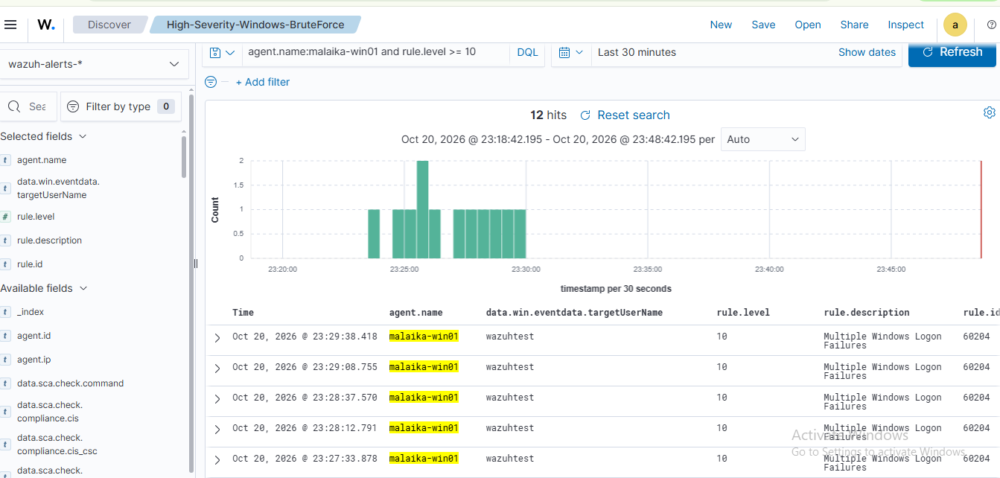<br>
  <em>Exhibit 21 — Saved search <code>High-Severity-Windows-BruteForce</code> with columns added, last 30 minutes</em>
</p>


### Step 22 — Widen the window to 24 hours ✅

With the range at Last 24 hours the same 12 hits remain, in 30-minute buckets. This is the window used for the exports, because a 30-minute range would return 0 hits once the alerts age out.

<p align="center">
  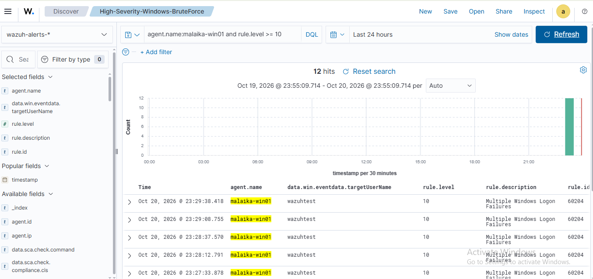<br>
  <em>Exhibit 22 — Same saved search over the last 24 hours: 12 hits, window used for the export</em>
</p>


### Step 23 — Generate the CSV report ✅

The Reporting menu offers `Generate CSV` and `Generate XLSX`. The CSV on-demand report (generated 18:51:23 UTC) is saved as `evidence/high-severity-alerts.csv`.

<p align="center">
  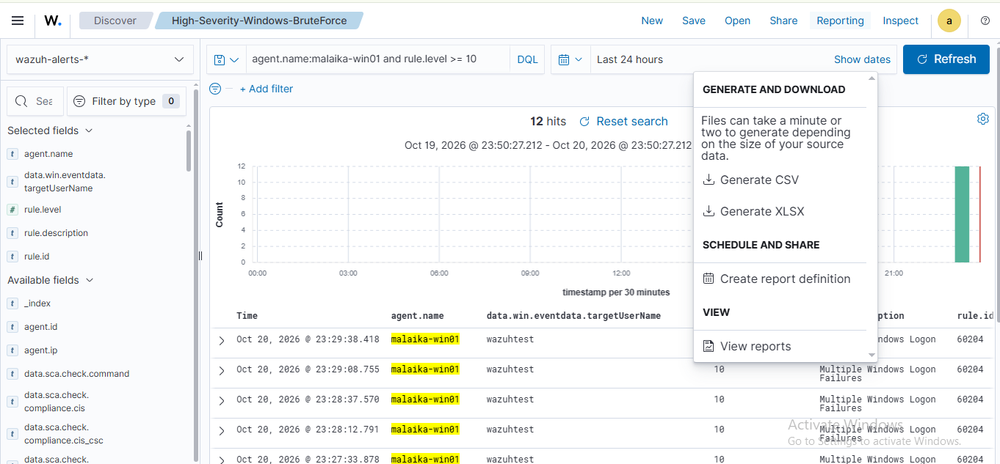<br>
  <em>Exhibit 23 — Reporting menu: Generate CSV / Generate XLSX</em>
</p>


### Step 24 — Inspect the query ✅

The Inspect panel confirms 12 hits, index pattern `wazuh-alerts-*`, query time 26 ms and request timestamp `2026-10-20T18:58:12.966Z`. The Response tab was copied and saved as `evidence/high-severity-alerts.json`.

<p align="center">
  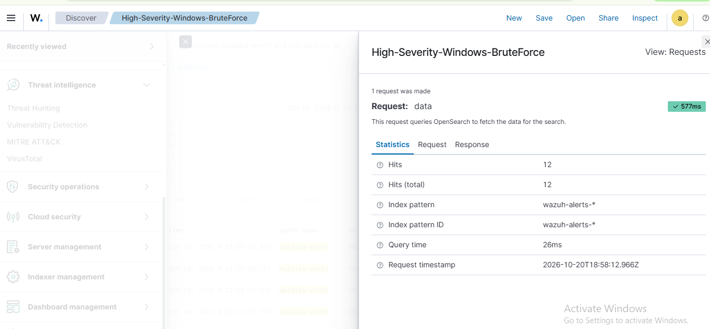<br>
  <em>Exhibit 24 — Inspect panel: 12 hits, index pattern <code>wazuh-alerts-*</code>, request timestamp 2026-10-20T18:58:12Z</em>
</p>


### Step 25 — Dashboard overview, last 24 hours ✅

The Overview page counts 0 critical, 0 high, 12 medium and 18 low alerts. The 12 medium alerts are the level-10 brute-force alerts, since Wazuh groups levels 7–11 as medium. The Agents Summary widget showed "No results" when this was captured, while the Endpoints page (Exhibit 16) lists the agent as active.

<p align="center">
  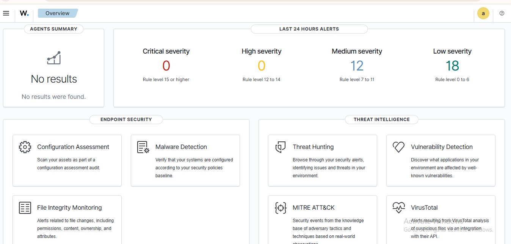<br>
  <em>Exhibit 25 — Overview, last 24 hours: 0 critical, 0 high, 12 medium, 18 low alerts</em>
</p>


---

<a id="coverage-snapshot"></a>
## 🌟 Coverage Snapshot

| 🛡️ Area | ✅ Status | 📌 Detail |
|---|---|---|
| Server deployment | Complete | Wazuh 4.9.2 all-in-one on Azure, after an existing install and a failed first reinstall |
| Agent enrollment | Complete | `malaika-win01` active after matching the agent version to the manager |
| Detection | Complete | 12 alerts from rule 60204 (level 10, T1110) found, saved as a search and exported |
| Remote attacker | Not covered | The simulation ran on the endpoint itself (source `127.0.0.1`) |

### 🧾 What the Evidence Proves

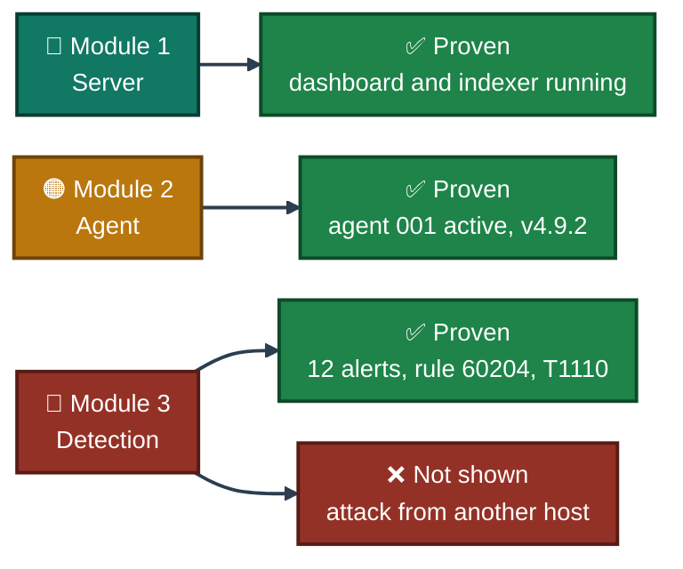

---

<a id="troubleshooting-pipeline"></a>
## 🧭 Troubleshooting Pipeline

How a failed step becomes a documented, verified fix

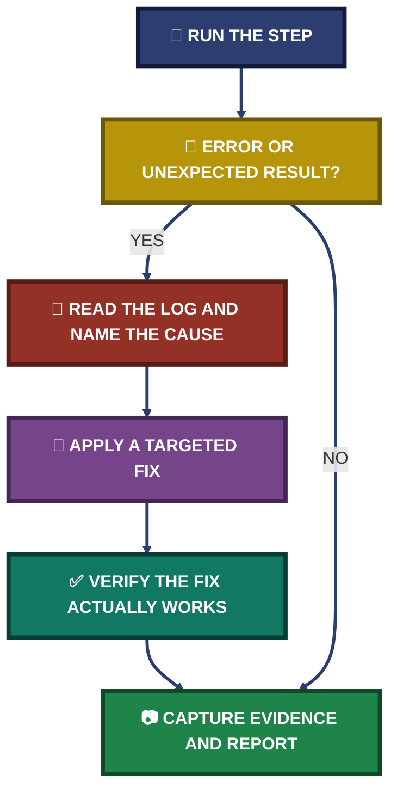

---

<a id="command-reference"></a>
## 🧰 Command Reference

| # | Command | Used In | Purpose |
|:---:|---|---|---|
| 1 | `ssh -i <key>.pem azureuser@172.198.75.105` | Module 1 | Log in to the Azure VM with the key file |
| 2 | `curl -sO https://packages.wazuh.com/4.9/wazuh-install.sh && sudo bash wazuh-install.sh -a` | Module 1 | All-in-one Wazuh install |
| 3 | `sudo systemctl status wazuh-manager wazuh-indexer wazuh-dashboard --no-pager` | Module 1 | Check the three services |
| 4 | `sudo bash wazuh-install.sh -a -o` | Module 1 | Overwrite and reinstall |
| 5 | `sudo tar -O -xvf ~/wazuh-install-files.tar wazuh-install-files/wazuh-passwords.txt \| grep -A1 "admin"` | Module 1 | Read the generated credentials |
| 6 | `Test-NetConnection 172.198.75.105 -Port 1514` (and `1515`) | Module 2 | Check manager reachability from the endpoint |
| 7 | `Get-WmiObject -Class Win32_Product \| Where-Object { $_.Name -like "*Wazuh*" } \| ForEach-Object { $_.Uninstall() }` | Module 2 | Remove the mismatched agent |
| 8 | `Remove-Item "C:\Program Files (x86)\ossec-agent" -Recurse -Force` | Module 2 | Delete leftover agent files |
| 9 | `msiexec /i wazuh-agent-4.9.2-1.msi /q WAZUH_MANAGER='172.198.75.105' WAZUH_AGENT_NAME='malaika-win01'` | Module 2 | Silent install of the matching agent version |
| 10 | `NET START WazuhSvc` | Module 2 | Start the agent service |
| 11 | `Get-Content "C:\Program Files (x86)\ossec-agent\ossec.log" -Tail 15` | Module 2 / 3 | Read the agent log |
| 12 | `net user wazuhtest "<password>" /add` | Module 3 | Create the local test account |
| 13 | `1..10 \| ForEach-Object { net use \\127.0.0.1\IPC$ /user:wazuhtest "wrong$_" 2>&1 \| Out-Null; Start-Sleep -Seconds 1 }` | Module 3 | Generate failed logons |
| 14 | `agent.name:malaika-win01 and rule.level >= 10` | Module 3 | Discover query for the high-severity alerts |

---

<a id="project-summary"></a>
## 📝 Project Summary

| Module | Tooling | Key Outcome |
|---|---|---|
| Module 1 — Server Deployment | Azure VM, Ubuntu 24.04.5, Wazuh 4.9.2 | Working all-in-one Wazuh after an existing install and a Filebeat failure |
| Module 2 — Agent Enrollment | PowerShell, Wazuh agent 4.9.2 | Agent `malaika-win01` active after a version-mismatch fix |
| Module 3 — Detection | Wazuh Discover, Reporting, Inspect | 12 alerts (rule 60204, level 10, T1110) found, saved, exported as CSV and JSON |

---

<a id="challenges-fixes"></a>
## ⚠️ Challenges & Fixes

| ❌ Challenge | ✅ Fix |
|---|---|
| Installer refused to run because Wazuh was already installed, and the credentials archive was missing | Re-ran the installer with `-a -o` to overwrite the existing installation |
| Passwords tool rejected the new password | Read the policy in the error message (8–64 characters, upper and lower case, number, symbol); the final credentials came from the reinstall |
| First reinstall failed with `filebeat could not be started` | The script cleaned up; a second full reinstall completed |
| Dashboard login returned `Invalid username or password` | Re-read the generated credentials from the install archive |
| Agent could not register: `Agent version must be lower or equal to manager version` | Uninstalled the agent, deleted the leftover folder, reinstalled version 4.9.2 to match the manager |
| `ossec.log` not found right after the reinstall | Waited for the install to finish, started the service, and confirmed the files and log |
| 514 hits in Discover did not match the 12 alerts | Filtered with `rule.level >= 10`; the extra hits were other agent events |
| CSV export has no source-IP column | Columns in the table decide what the CSV contains; the JSON export holds the full event, including `ipAddress: 127.0.0.1` |

---

<a id="scope-limitations"></a>
## 🚧 Scope & Limitations

- **Loopback source:** All failed logons came from `127.0.0.1` on the endpoint itself. This shows detection works but not how an attack from another host would look.
- **One endpoint:** Only `malaika-win01` is enrolled.
- **Rule 60204 only in the saved search:** The `rule.level >= 10` filter returns only the correlated rule 60204 alerts. The many individual failed-logon events behind them are lower-severity and not counted in the 12.
- **"High severity" in the saved-search name:** Wazuh's Overview groups level 10 under *medium* (7–11). The saved search name refers to the filter `rule.level >= 10`.
- **CSV columns:** The CSV contains only the five selected columns. It has no source-IP column, and its header names contain backslashes (`agent\.name`), which is how this export writes them.
- **Credentials redacted:** Passwords visible in the original captures were blacked out in Exhibits 4, 6, 8, 17 and 18. The server and test-account passwords were exposed while the lab was built and should be changed if the environment is kept.
- **Timestamps:** The dashboard shows local time (UTC+5); the exports and server logs are UTC.
- **Test account:** `wazuhtest` was created for this lab only and should be removed afterwards with `net user wazuhtest /delete`.

These gaps are stated directly instead of hidden, so the results reflect what was actually built and verified.

---

<a id="what-i-learned"></a>
## 🧠 What I Learned

- **Agent and manager versions have to line up.** A newer agent cannot enroll in an older manager, and the log says so in one line. Reading `ossec.log` found the cause faster than reinstalling blindly.
- **A SIEM alert is a summary, not the raw event.** Rule 60204 is a correlation of many failed logons (event 4625), which is why 12 alerts sit on top of many more raw events and why the Discover hit count changes with the filter.

---

<a id="skills-demonstrated"></a>
## 🛠️ Skills Demonstrated

- Deploying and recovering a Wazuh all-in-one server on a cloud VM (installer options, service checks, credential recovery)
- Enrolling a Windows endpoint and diagnosing agent registration failures from `ossec.log`
- Simulating failed logons safely against a local test account and mapping them to MITRE T1110
- Searching, filtering, saving and exporting alerts in Wazuh Discover (DQL, columns, CSV and JSON)
- Writing a report that states the limits of its own evidence

---

<a id="screenshot-index"></a>
## 🖼️ Screenshot Index

| # | File | Shows |
|:---:|---|---|

| 1 | `ss-01-ssh-publickey-denied.PNG` | SSH to the Azure VM: placeholder hostname fails, password-less SSH is refused with Permission denied (publickey) |

| 2 | `ss-02-ssh-key-login-success.PNG` | SSH with the key file succeeds: Ubuntu 24.04.5 LTS on the Azure VM lab-server |

| 3 | `ss-03-installer-already-installed-services-active.PNG` | Installer reports Wazuh already installed; manager, indexer and dashboard show active (running), then are restarted |

| 4 | `ss-04-passwords-tool-rejected-overwrite-reinstall.PNG` | Credentials archive not found, password tool rejects a weak password, installer re-run with -a -o (credentials redacted) |

| 5 | `ss-05-first-reinstall-filebeat-error.PNG` | First clean reinstall fails with filebeat could not be started and is removed again |

| 6 | `ss-06-wazuh-install-finished.PNG` | Second reinstall completes: Installation finished (credentials redacted) |

| 7 | `ss-07-dashboard-login-rejected.PNG` | Dashboard login refused: Invalid username or password |

| 8 | `ss-08-credentials-read-from-archive.PNG` | Admin credentials re-read from the install archive with tar and grep (credentials redacted) |

| 9 | `ss-09-agent-install-service-started.PNG` | Agent install command run on Windows; NET START WazuhSvc reports the service is already started |

| 10 | `ss-10-manager-ports-1514-1515-reachable.PNG` | Test-NetConnection to the manager on ports 1514 and 1515: TcpTestSucceeded : True |

| 11 | `ss-11-agent-version-mismatch-error.PNG` | ossec.log: Agent version must be lower or equal to manager version; WazuhSvc not found |

| 12 | `ss-12-agent-uninstall.PNG` | Wazuh agent uninstalled through Win32_Product (ReturnValue : 0) |

| 13 | `ss-13-agent-folder-removed-reinstall-492.PNG` | Leftover ossec-agent folder removed; agent 4.9.2 MSI downloaded and installed silently |

| 14 | `ss-14-service-started-after-reinstall.PNG` | WazuhSvc was stopped, then started successfully; ossec.log not created yet |

| 15 | `ss-15-agent-directory-listing.PNG` | ossec-agent directory repopulated: ossec.conf, ossec.log, client.keys, wazuh-agent.exe |

| 16 | `ss-16-endpoints-agent-active.PNG` | Endpoints page: agent 001 malaika-win01, Windows 10 Pro, v4.9.2, status active |

| 17 | `ss-17-agent-log-connected-test-user-created.PNG` | ossec.log shows the agent connected and online; local test user wazuhtest created (password redacted) |

| 18 | `ss-18-failed-logon-loop-simulation.PNG` | Failed-logon loop against \\127.0.0.1\IPC$ with wrong passwords, run repeatedly (password redacted) |

| 19 | `ss-19-discover-agent-events-514-hits.PNG` | Discover, agent.name:malaika-win01, last 24 hours: 514 hits of all agent events |

| 20 | `ss-20-discover-high-severity-12-hits-raw.PNG` | Discover with rule.level >= 10: 12 hits, raw _source view |

| 21 | `ss-21-saved-search-columns-30min.PNG` | Saved search High-Severity-Windows-BruteForce with columns added, last 30 minutes |

| 22 | `ss-22-saved-search-24h-12-hits.PNG` | Same saved search over the last 24 hours: 12 hits, window used for the export |

| 23 | `ss-23-reporting-generate-csv.PNG` | Reporting menu: Generate CSV / Generate XLSX |

| 24 | `ss-24-inspect-request-statistics.PNG` | Inspect panel: 12 hits, index pattern wazuh-alerts-*, request timestamp 2026-10-20T18:58:12Z |

| 25 | `ss-25-overview-last-24h-alerts.PNG` | Overview, last 24 hours: 0 critical, 0 high, 12 medium, 18 low alerts |


**Evidence files:** `evidence/high-severity-alerts.csv` (12 rows) and `evidence/high-severity-alerts.json` (12 full alert documents).

---

<a id="repo-structure"></a>
## 📁 Repo Structure

```text
project-20-windows-bruteforce-detection-wazuh/
|-- README.md
|-- INDEX.md
|-- evidence/
|   |-- high-severity-alerts.csv
|   `-- high-severity-alerts.json
`-- screenshots/

    |-- ss-01-ssh-publickey-denied.PNG

    |-- ss-02-ssh-key-login-success.PNG

    |-- ss-03-installer-already-installed-services-active.PNG

    |-- ss-04-passwords-tool-rejected-overwrite-reinstall.PNG

    |-- ss-05-first-reinstall-filebeat-error.PNG

    |-- ss-06-wazuh-install-finished.PNG

    |-- ss-07-dashboard-login-rejected.PNG

    |-- ss-08-credentials-read-from-archive.PNG

    |-- ss-09-agent-install-service-started.PNG

    |-- ss-10-manager-ports-1514-1515-reachable.PNG

    |-- ss-11-agent-version-mismatch-error.PNG

    |-- ss-12-agent-uninstall.PNG

    |-- ss-13-agent-folder-removed-reinstall-492.PNG

    |-- ss-14-service-started-after-reinstall.PNG

    |-- ss-15-agent-directory-listing.PNG

    |-- ss-16-endpoints-agent-active.PNG

    |-- ss-17-agent-log-connected-test-user-created.PNG

    |-- ss-18-failed-logon-loop-simulation.PNG

    |-- ss-19-discover-agent-events-514-hits.PNG

    |-- ss-20-discover-high-severity-12-hits-raw.PNG

    |-- ss-21-saved-search-columns-30min.PNG

    |-- ss-22-saved-search-24h-12-hits.PNG

    |-- ss-23-reporting-generate-csv.PNG

    |-- ss-24-inspect-request-statistics.PNG

    `-- ss-25-overview-last-24h-alerts.PNG

```

<div align="center">

🛡️ **[Wazuh](https://wazuh.com)** · ☁️ **[Microsoft Azure](https://azure.microsoft.com)** · 🐧 **[Ubuntu Server](https://ubuntu.com/server)** · 🧭 **[Troubleshooting Pipeline](#troubleshooting-pipeline)**

</div>
